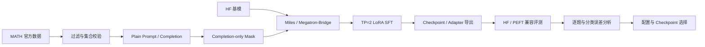

# 数学推理的分布式 LoRA SFT 训练与评测

围绕数学推理任务开展的 **Slime 系列框架复现与适配项目**，使用 Miles / Megatron-Bridge 完成分布式 LoRA SFT，关注训练数据与推理模板的一致性、TP 模块映射、adapter 导出以及 HF/PEFT 兼容评测。

**技术栈：** Python · PyTorch · Miles · Megatron-Bridge · LoRA · HF/PEFT · SGLang · 2×RTX 5090

## 项目解决什么问题

- **显存与训练成本：** 冻结基模、仅更新 LoRA adapter，在两卡环境完成参数高效微调。
- **训练与推理不一致：** prompt 格式和监督范围不一致会影响数学输出，需统一 Plain Prompt/Completion 与 completion-only loss。
- **跨框架兼容：** Megatron 的 fused 模块与 TP 分片布局，需要正确对应 HF/PEFT 的模块、权重方向及 scaling。

## 主要工作

### 1. 组织数学数据，统一监督与评测协议

对 MATH 官方 train/test parquet 统一执行 **level 3/4、非 Geometry、包含 boxed answer**过滤，构造 **train 2,000 / eval600**，检查 unique_id 不重合并进行种子核验。围绕格式错配采用 Plain Prompt/Completion，仅监督 completion token。

### 2. 跑通分布式 LoRA SFT 链路

围绕 **HF checkpoint → Megatron-Bridge → LoRA 训练 → distributed checkpoint → HF/PEFT / SGLang**组织接入与验证。实验冻结 base，仅更新 adapter，在 **2×RTX 5090、TP=2**下完成训练配置与运行排障。

### 3. 对齐模块映射与 adapter 兼容性

结合 fused QKV、Gate/Up、Down 模块与 TP 布局核查适配语义；围绕零初始化输出、逐层 **ΔW = BA**及 Megatron/HF PEFT logits 对齐开展兼容验证，排查转置、切分、scaling 和导出格式问题。评测脚本兼容 adapter key prefix 与 target_modules。

### 4. 用误差分析选择配置

对比 r8 / r16、不同 checkpoint 和模板，统计 correct flips、答案抽取为空、输出长度及 subject 分布；保留模型与 prompt 协议，避免将不同基模或格式的结果混成同一消融。

## 系统架构



## 项目效果

采用 **Qwen2.5-7B base、Plain Prompt、MATH eval600**评测协议：

| 模型配置 | 正确题数 | 准确率 |
|---|---:|---:|
| Base | 201/600 | 33.50% |
| **Base + LoRA r8** | **275/600** | **45.83%** |
| Base + LoRA r16 | 271/600 | 45.17% |

**r8 相较 Base 提升 12.33 个百分点，净增 74 题。** 原始摘要见 `evidence/metrics/`；配置和分析见 [实验报告](docs/miles_base_plain_lora_experiment_report.md)。

## 快速运行

无需 GPU，查看保存的指标：

```bash
python3 scripts/summarize_metrics.py
python3 scripts/analyze_plain_lora_eval_compare.py --help
```

准备模型与 adapter 后，进行 HF/PEFT 生成评测（Python 3.10+）：

```bash
python3 -m pip install -r requirements-eval.txt
python3 scripts/eval_hf_math_plain_lora.py \
  --model /path/to/Qwen2.5-7B \
  --adapter /path/to/adapter \
  --data /path/to/math_plain_eval600.jsonl \
  --output outputs/lora-eval.jsonl
```

训练入口与环境变量见 [运行说明](docs/RUNNING.md)。

## 代码导航

| 文件 | 内容 |
|---|---|
| `scripts/create_math_plain_sft_eval.py` | 数据过滤、抽样与 Plain 格式构造 |
| `own/rollout/plain_sft_rollout.py` | SFT sample 与 completion-only mask |
| `scripts/run_plain_lora_sft.sh` | 显式环境变量训练入口 |
| `scripts/eval_hf_math_plain_lora.py` | HF/PEFT adapter 加载与数学评测 |
| `scripts/analyze_plain_lora_eval_compare.py` | 逐题翻转、答案抽取与长度分析 |
| `evidence/` | 保存的评测摘要 |
